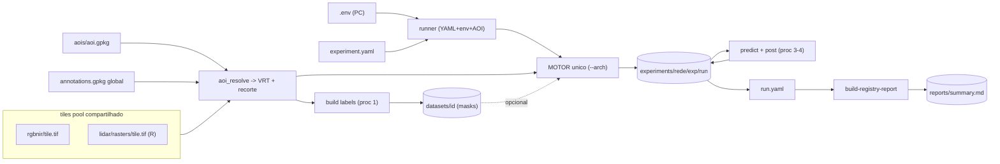

# 00_PHD_MSB_RUN - fluxo de experimentos (leucaena)

Raiz unica dos experimentos de doutorado. **Um motor** para todas as redes
(MANet, ResUNet e as proximas), configurado por um `experiment.yaml` nomeado,
sobre um **POOL central de tiles** (sem duplicar raster). Cada AOI e apenas um
`.gpkg` que seleciona tiles e filtra um `annotations.gpkg` global.

O codigo vive no repo (`scripts/phd-run/`, `pipeline/aoi_resolve.py`,
`reports/build-registry-report.py`). Esta pasta guarda **dados + saidas**.

## Estrutura

```text
00_PHD_MSB_RUN/
  tiles/                      # POOL (1 copia por tile, serve a TODOS os AOIs)
    rgbnir/<tile>.tif
    lidar/rasters/<tile>.tif  # saida do orquestrador R (CHM+INTENSITY)
    lidar/raw/*.laz  lidar/products/*
  aois/<aoi>.gpkg             # footprints dos tiles do AOI (NOMENC_2K/5K/10K)
  annotations/*.gpkg          # GLOBAL (todas as classes) - filtrado por AOI
  datasets/<aoi>__lbl-v<N>/   # derivados reutilizaveis (masks; patches se pedir)
    _resolve/ (VRTs + annotations recortado)   masks/ (rotulos+distancia)
  experiments/<rede>/<nome>/<run>/  # saidas por rede/experimento/run
    models/ figs/ logs/ metrics/ predictions/<aoi>/ run.yaml
  reports/summary.md  summary.csv   # relatorio agregado (todos os runs)
```

**AOI1 engloba AOI2** => os dois `.gpkg` apontam p/ tiles do mesmo pool: zero
duplicacao. `dataset_id = <aoi>__lbl-v<N>` (`N` = versao do rotulo; ganha
`__p<size>` so se `save_patches: true`).

## Fluxo



## Antes de rodar (uma vez por PC)

No repo, copie `.env.example` para `.env` e ajuste **so** o que muda por PC:

```ini
PHD_RUN_ROOT=C:/00_PHD_MSB_RUN     # lab: E:/dados-msb/00_PHD_MSB_RUN
TRAIN_PROFILE=home                 # home | lab (batch/workers via profiles no yaml)
# R_BIN=C:/Program Files/R/R-4.4.1/bin/Rscript.exe   # so se Rscript nao estiver no PATH
```

Tudo o mais (rede, fusion, task, patch, epochs, loss, pesos...) fica no
`experiments/<rede>/<nome>/experiment.yaml` - **o unico lugar** para editar o
modelo. Trocar de rede = mudar `network:`.

LiDAR: gere `tiles/lidar/rasters/<tile>.tif` (CHM+INTENSITY) com o orquestrador R
em `scripts/lidar-products/` (serve a todas as redes/AOIs).

## Como rodar (4 procs, comandos em minusculo)

Via PowerShell (`scripts/phd-run/run.ps1`) ou Python (`scripts/phd-run/run.py`):

```powershell
cd <repo>   # raiz do leucaena-earth-segmentation

# LiDAR do AOI (pool em PHD_RUN_ROOT; usa NOMENC do gpkg)
.\run_lidar.ps1 -aoi 261002-riodaspedras

# proc 1 - rotulos do AOI (resolve tiles -> VRT -> recorta annotations -> masks)
.\run.ps1 labels  -aoi 261002-riodaspedras -experiment manet/latefusion-multitask -run run-001
# proc 2 - treino (motor unico, on-the-fly lendo os VRTs)
.\run.ps1 train   -aoi 261002-riodaspedras -experiment manet/latefusion-multitask -run run-001
# proc 3 - predicao (mesma OU outra AOI; reusa os pesos do run, NAO cria run novo)
.\run.ps1 predict -aoi 260515-piracicaba   -experiment manet/latefusion-multitask -run run-001
# proc 4 - pos-processo do pred_dist
.\run.ps1 post    -aoi 260515-piracicaba   -experiment manet/latefusion-multitask -run run-001
# relatorio agregado (todos os runs)
.\run.ps1 report
# tudo de uma vez (resolve->labels->train->predict->post):
.\run.ps1 all     -aoi 261002-riodaspedras -experiment manet/latefusion-multitask -run run-001
```

Opcoes do runner: `-aoi`, `-experiment <rede>/<nome>`, `-run run-00N`,
`-profile home|lab`, `-runtime docker|host`, `--init-from <pesos>` +
`--parent-run run-00M` (finetune), `--dry-run` (so imprime os comandos).

### Regra dos runs (numeracao)
- **train** (do zero) -> nasce `run-00X`, produz pesos.
- **predict** em outra AOI -> **mesmo run**; grava em `run-00X/predictions/<aoi>/`
  e anexa item em `predictions:` do `run.yaml`.
- **finetune** (`--init-from`) -> `run-00Y` novo com `parent_run` + `init_from`.
- Rede nova = experimento novo = **comeca em run-001** (pesos diferentes).

## Opcoes do motor (valores reais do 02_train.py)

| botao | flag | valores |
|---|---|---|
| Rede | `--arch` | `unet, unetplusplus, manet, linknet, BPATUNet, resunet` |
| Fonte | `--latefusion` | 2 bracos (RGBNIR + CHM/LiDAR) ou single-source |
| Fusao | `--fusion` | `concat, gated, xattn` (so com latefusion) |
| Tarefa | task | `multitask` (dist+classe), `classification`, `regression` |
| Norm RGB | `--rgb_norm_method` | `minmax, constant` |
| Norm LiDAR | `--lidar_norm` | `minmax, values` (escopo `band, global`) |
| Pesos classe | `--class_weights` | `none, inverse, median, effective, manual` |
| Loss reg | `--reg_loss` | `l1, mse, smooth_l1` |
| Mascara reg | `--reg_mask_source` | `label, dist` |
| Extras | - | `--dist_guided, --learn_task_weights, --oversample, --ignore_index, --pseudo_teacher` |

Cada combinacao e so um `experiment.yaml`. Flags nao mapeadas vao em
`train_extra_args:` (repassadas verbatim ao motor).

## Experimentos atuais

| experimento (`-experiment`) | rede | tarefa | obs |
|---|---|---|---|
| `manet/latefusion-multitask` | manet | multitask | "versao B" (professor); dist+classe, 6 classes |
| `resunet/latefusion` | resunet | classification | "versao A" ressuscitada no mesmo motor |

Para uma rede nova: copie uma pasta de experimento, troque `network:` e rode
`run train -experiment <rede>/<nome> -run run-001`. Usar o **mesmo nome de
experimento** (ex.: `latefusion-multitask`) em redes diferentes agrupa a
comparacao no `reports/summary.md`.

## Onde cai cada resultado
- `datasets/<id>/masks/` - rotulos+distancia (reutilizaveis por varios runs).
- `experiments/<rede>/<nome>/<run>/models/` - pesos.
- `.../<run>/predictions/<aoi>/` - `pred_class.tif`, `pred_dist.tif` (proc 3) e
  `pred_dist_gauss_*.tif`, `pred_dist_bin_*.tif` (proc 4, junto da predicao).
- `.../<run>/run.yaml` - registry (timestamps proc 1-4, metricas, changes, predictions).
- `reports/summary.md` + `.csv` - comparativo global + **matriz treino x predicao**.
